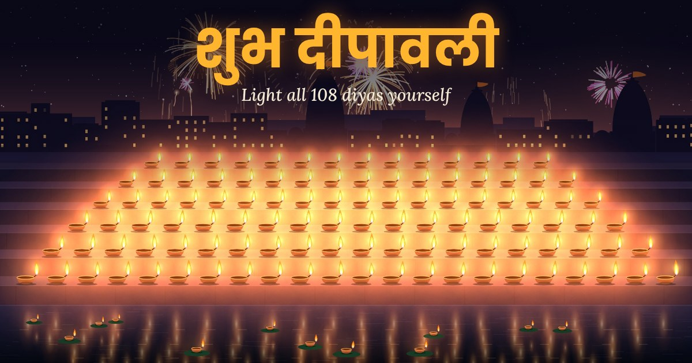
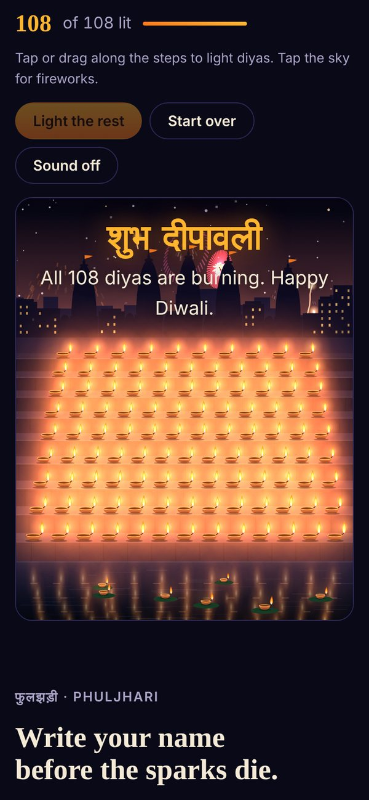
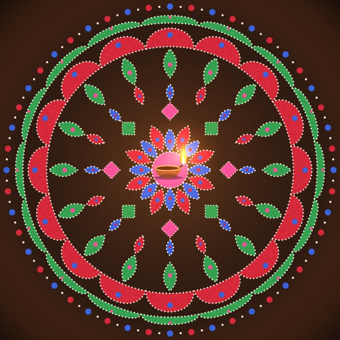
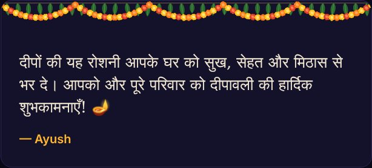

<div align="center">

<a href="https://diwali-deepmala.onrender.com">
  
</a>

# 🪔 Diwali Deepmala

### शुभ दीपावली · Happy Diwali

**An interactive Diwali night you light up yourself.**<br>
108 diyas on a river ghat, fireworks, a sparkler, a rangoli floor and a wish for the family.

<br>

<a href="https://diwali-deepmala.onrender.com"></a>


<br><br>

### [✨ Open the live site ✨](https://diwali-deepmala.onrender.com)

</div>

<br>

## About

Diwali falls on **Kartik Amavasya**, the new-moon night and the darkest of the month. So the page opens almost dark, with a single diya burning on the ghat steps, and **you** pass the flame along.

There are **108 diyas**, one for each bead of a mala. Tap or drag across the steps to light them. As the ghat fills with light, windows across the town wake up and the temple flags begin to glow. When the last diya is lit, the sky bursts into a fireworks finale and floating diyas drift down the river.

<br>

## What you can do

<table>
  <tr>
    <td width="50%" valign="top">
      
      <h3>🪔 Light 108 diyas</h3>
      Tap or drag along the ghat steps, or press <b>Light the rest</b> and watch the flame travel step to step. Tap the sky to launch fireworks: peony, ring, willow, strobe and double bursts.
    </td>
    <td width="50%" valign="top">
      
      <h3>🎇 Write with a phuljhari</h3>
      Drag across the dark to write your name with a sparkler. Its sparks branch and fall like the real thing. Turn on <b>Keep the trail</b> to hold your writing still for a screenshot.
    </td>
  </tr>
  <tr>
    <td width="50%" valign="top">
      
      <h3>🌸 Draw a rangoli</h3>
      Pick a powder (chawal, haldi, genda, kumkum, gulaal, neel or patta) and draw. Every stroke mirrors 6, 8 or 12 ways around the diya at the centre. Press <b>New pattern</b> for a fresh design.
    </td>
    <td width="50%" valign="top">
      
      <h3>💌 Send a wish</h3>
      Add your name, choose <b>हिन्दी</b>, <b>English</b> or <b>Hinglish</b>, and copy a ready-made Diwali message for the family WhatsApp group.
    </td>
  </tr>
</table>

<br>

## The five nights of Diwali 2026

| Night | Date | Festival | |
|:-:|:--|:--|:--|
| 1 | Fri, 6 Nov | **धनतेरस** · Dhanteras | Buying new metal, a lamp at the door for Yama |
| 2 | Sat, 7 Nov | **छोटी दिवाली** · Choti Diwali | Krishna's victory over Narakasura |
| 3 | Sun, 8 Nov | **लक्ष्मी पूजा** · Lakshmi Puja | The new-moon night, when every home is lit 🪔 |
| 4 | Tue, 10 Nov | **गोवर्धन पूजा** · Govardhan Puja | Krishna lifts Govardhan hill; annakut offering |
| 5 | Wed, 11 Nov | **भाई दूज** · Bhai Dooj | Sisters put a tilak on their brothers' foreheads |

<sub>Some calendars place Govardhan Puja and Bhai Dooj a day earlier, on 9 and 10 November. The page highlights whichever night it is when you open it.</sub>

<br>

## Small touches

- **Sound you switch on yourself:** temple bell, firework booms and crackle, sparkler hiss. All of it is generated live in the browser, with no audio files.
- **A marigold toran** of genda flowers and mango leaves hangs across the top like a doorway.
- **Printable greeting card:** a two-page PDF, [`Shubh-Deepavali-2026.pdf`](Shubh-Deepavali-2026.pdf), linked from the page footer.
- **WhatsApp-ready link preview:** sharing the link shows the lit ghat with "शुभ दीपावली".
- **Works on phones:** the ghat rearranges into more, narrower steps on small screens.
- **Respects reduced motion:** if a device asks for less animation, the flames calm down and ambient fireworks stop.

<br>

## Project structure

```
.
├── index.html                 # the whole interactive page: markup, styles and canvas scripts
├── og-image.jpg               # link preview image for WhatsApp and social apps
├── Shubh-Deepavali-2026.pdf   # printable two-page greeting card
├── render.yaml                # Render static-site configuration
└── docs/                      # screenshots used in this README
```

Everything is drawn on HTML canvas in plain JavaScript. There are no frameworks, libraries or images inside the page itself. The only outside resource is the Google Fonts stylesheet for Eczar and Mukta.

<br>

## Run it locally

Open `index.html` in any modern browser. To serve it the way Render does:

```bash
python3 -m http.server 8000
# then open http://localhost:8000
```

<br>

## Deploy your own

The site is a static site on Render, configured by [`render.yaml`](render.yaml):

1. Fork this repository.
2. In the [Render dashboard](https://dashboard.render.com), choose **New → Blueprint** and select your fork.
3. Render publishes it at `https://<your-service-name>.onrender.com`. Every push to `main` redeploys it.

If your address is different, update the `og:url` and `og:image` lines near the top of `index.html` so the link preview keeps working.

<br>

---

<div align="center">

Made with 🪔 by **[Ayush Jaiswal](https://github.com/AYUshJaiswal454)** for Diwali 2026

**शुभ दीपावली!** May your home be full of light, health and sweetness.

</div>
